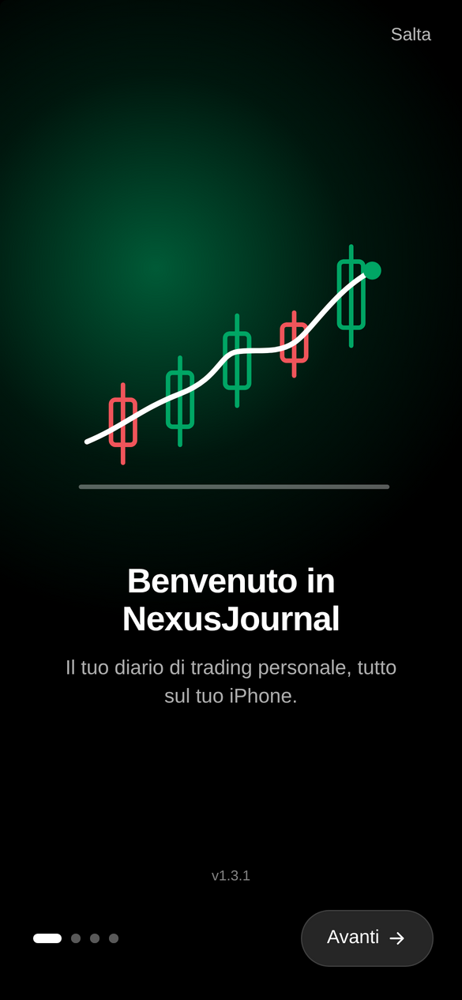
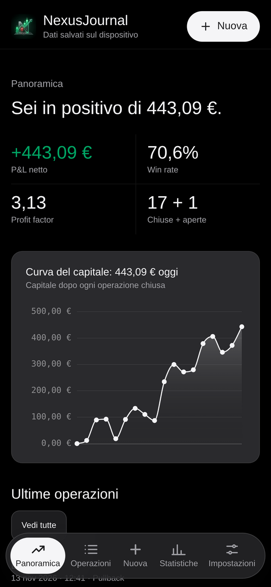
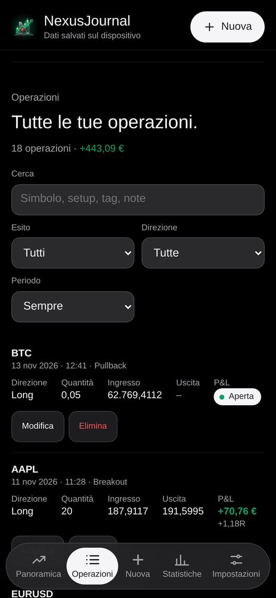
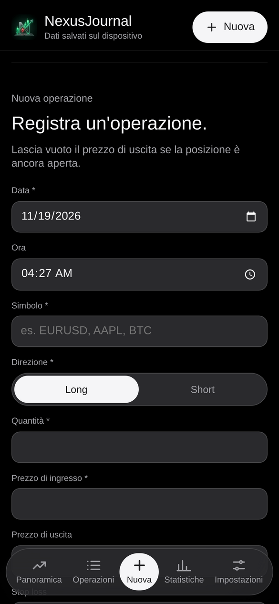
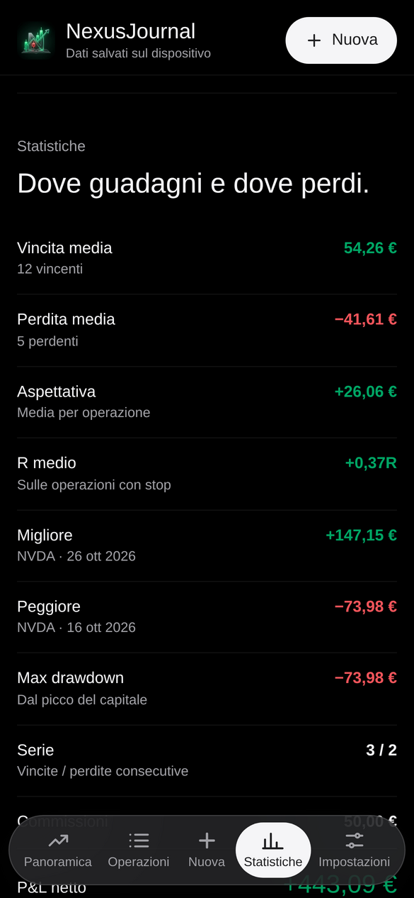
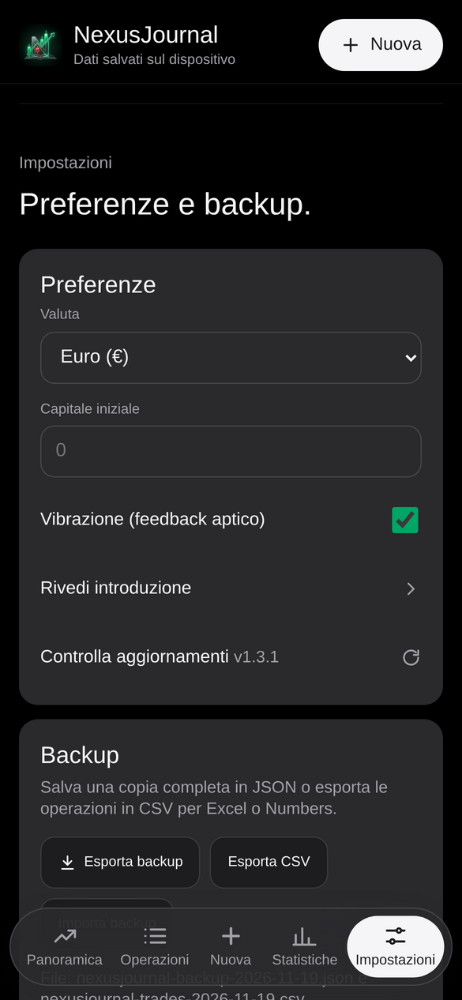

# NexusJournal

**Il tuo diario di trading personale, nero, fluido e tutto sul tuo iPhone.**

 
 
 
 

  

<a href="https://albaexe.github.io/NexusJournal/"><b>Apri NexusJournal →</b></a>

---

## Screenshot

<table>
<tr><td align="center"> <b>Introduzione</b></td><td align="center"> <b>Panoramica</b></td><td align="center"> <b>Operazioni</b></td></tr>
<tr><td align="center"> <b>Nuova operazione</b></td><td align="center"> <b>Statistiche</b></td><td align="center"> <b>Impostazioni</b></td></tr>
</table>

## Cos'è

NexusJournal è una web app installabile (PWA) per registrare e analizzare ogni operazione di trading. Pensata per un solo utente, funziona offline e salva tutto in locale sul dispositivo: nessun account, nessun server.

## Funzioni

### Panoramica
- P&L netto con contatore animato e frase di sintesi
- Win rate, profit factor, operazioni chiuse e aperte
- Curva del capitale interattiva
- Ultime operazioni

### Operazioni
- Elenco completo con ricerca per simbolo, setup, tag e note
- Filtri per esito, direzione e periodo
- Modifica ed eliminazione di ogni operazione

### Nuova operazione
- Data e ora, simbolo, direzione Long/Short
- Quantità, prezzo di ingresso e uscita (vuoto = posizione aperta), stop loss, commissioni
- P&L e R-multiplo calcolati in automatico
- Setup, tag, emozione, voto esecuzione, note e screenshot del grafico

### Statistiche
- Vincita e perdita media, aspettativa, R medio
- Migliore e peggiore operazione, max drawdown
- Serie di vincite e perdite consecutive

### Impostazioni
- Valuta e capitale iniziale
- Vibrazione (feedback aptico) on/off
- Rivedi introduzione, controlla aggiornamenti
- Backup JSON, esportazione CSV, importazione, dati di esempio

### Esperienza
- Tema nero OLED, icone animate, transizioni fluide
- Feedback aptico al tocco su iPhone
- Schermate introduttive alla prima apertura
- Nessuna selezione blu con pressione prolungata, come un'app nativa
- **Aggiornamento automatico**: all'apertura l'app controlla `version.json` e si ricarica da sola quando esce una nuova versione

## Installazione su iPhone

1. Apri **https://albaexe.github.io/NexusJournal/** in Safari
2. Tocca **Condividi** → **Aggiungi alla schermata Home**
3. Lascia attivo **Apri come app web** e conferma

Su Android: Chrome → menu ⋮ → **Installa app**. Su desktop si apre direttamente nel browser.

## Dati e privacy

Tutte le operazioni restano nella memoria locale del dispositivo (`localStorage`). Se elimini l'app dalla schermata Home i dati vengono cancellati: usa **Impostazioni → Esporta backup** e salva il file su File o iCloud.

## Struttura del repository

| File | Contenuto |
|---|---|
| `index.html` | L'intera app (HTML, CSS, JS) |
| `hark*.css`, `hark*.js`, `chart.js`, `datalabels.js` | Stili e grafici |
| `apple-touch-icon.png`, `icon-192.png`, `icon-512.png` | Icone |
| `version.json` | Versione pubblicata, letta dall'aggiornamento automatico |
| `docs/screenshots/` | Screenshot aggiornati a ogni versione |

## Versione

**v1.3.1** · aggiornato il 19/11/2026

Uso personale · © ALBAEXE

